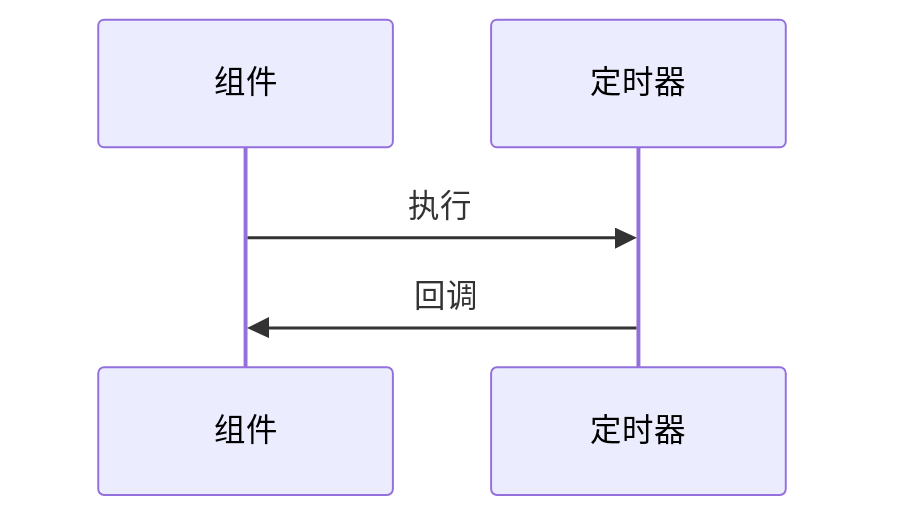

# vuepress-notes
学习笔记

## 参考资料：

### 预览地址
[lxysy.github.io/vuepress-notes/](https://lxysy.github.io/vuepress-notes/)

### 框架：
https://vuepress.vuejs.org/zh/

### 主题：
http://v1.vuepress-reco.recoluan.com/views/1.x/

### 文章：
https://juejin.cn/post/7189073364365869093?searchId=20231019100419A26FC2508D2F3E32F2BA#heading-18
自动化部署
https://juejin.cn/post/6937532951223599141

### 插件：

樱花效果
vuepress-plugin-sakura
```shell
npm install vuepress-plugin-sakura -D
```

鼠标点击效果
vuepress-plugin-cursor-effects
```shell
npm install vuepress-plugin-cursor-effects -D
```

### 部署

项目使用 GitHub Actions 自动构建与部署。

**工作流文件：** `.github/workflows/doc.yml`

流程：
1. 推送到 `main` 分支自动触发
2. 使用 Node 18 安装依赖（`npm ci`）
3. 构建静态文件（`npm run docs:build`）
4. 通过 `peaceiris/actions-gh-pages` 将构建产物推送到 `gh-pages` 分支
5. GitHub Pages 自动从 `gh-pages` 分支部署

> **关于 `--openssl-legacy-provider`：** VuePress 1.x 依赖 webpack 4，而 `terser-webpack-plugin@1` 硬编码用 `md4` 计算缓存 key。Node 17+ 的 OpenSSL 3 移除了 md4，构建会报 `ERR_OSSL_EVP_UNSUPPORTED`，必须加这个参数；但 Node 16 根本不认识它（该参数是 Node 17 才引入的），传了反而报错。
>
> 因此 `scripts/vuepress.js` 会读 `process.versions.node` 判断主版本号：≥17 才自动追加该参数，否则不加。`docs:dev` / `docs:build` 都走这个包装脚本，本地和 CI（Node 18）用同一条命令即可，不需要再各自设置 `NODE_OPTIONS`。

## 图片与图床

配图**不进博客仓库**，统一托管在独立的公开仓库，通过 jsDelivr 以 CDN 链接引用。

### 为什么要分离

仓库内位图峰值 22.78 MB / 187 张，每次 `git push` 都要把这些二进制传一遍，CI 还要把整个 `dist`（38 MB）强推到 `gh-pages`。把其中 175 张文章配图（20.68 MB）迁出后：

| 指标 | 改前 | 改后 |
|---|---|---|
| 博客仓库内位图 | 22.78 MB | 约 2 MB（站点标识图 + 少量未引用文件） |
| 图床存储体积 | — | 6.17 MB（压缩后，−70.2%） |
| 构建产物 `dist` | 38 MB | 17 MB |

压缩策略：宽度 > 1600px 等比缩到 1600，逐张在「PNG 无损重压缩」与「WebP q82」之间取小者（WebP 必须小 10% 以上才采用，两个候选都不如原图则原样保留）。

### 图床信息

| 项 | 值 |
|---|---|
| 仓库 | `lxysy/vuepress-notes-assets`（public） |
| CDN | `https://gcore.jsdelivr.net/gh` |
| 分支 | `@main` |
| 目录结构 | 镜像 `docs/` 下的相对路径 |
| 宽高清单 | `docs/.vuepress/images-manifest.json` |

引用格式：

```markdown

```

本地 `docs/src/ai/img/example.png` 对应图床上的 `src/ai/img/example.png`，只是多了前缀。

### 三种写图方式

#### 方式一：Typora 自动上传（推荐）

在 Typora 偏好设置中配置：

| 项 | 值 |
|---|---|
| 插入图片时 | 选**上传图片**，勾选「对本地位置的图片应用上述规则」 |
| 上传服务 | 自定义命令 |
| 命令 | `node F:\code\vuepress-notes\scripts\images.js typora` |

> 命令中的路径按本地实际克隆位置修改，必须是绝对路径。

粘贴截图后会依次完成：上传图床 → 推送 → 插入 CDN 链接 → 补宽高清单 → 把本地临时文件移进 `.images-trash/`。

#### 方式二：本地写相对路径，提交时自动同步

图片照旧放在 `docs/src/ai/img/` 用相对路径引用，然后正常 `git commit`。`pre-commit` 钩子会自动完成上传、改写引用、更新清单、清理本地文件，并把改好的文件加进本次提交。

```bash
# 先看会动什么，不实际执行
npm run images:sync -- --dry-run

# 手动触发（钩子已自动调用，一般不需要）
npm run images:sync
```

钩子靠 `core.hooksPath` 生效，新克隆的仓库需要执行一次：

```bash
git config core.hooksPath .githooks
```

> 钩子挂在 `pre-commit` 而不是 `pre-push`：它改写的是 md 内容，必须在提交生成**之前**完成，否则推上去的 commit 里还是本地路径，而图片已经被清理，线上直接裂图。

#### 方式三：手写 CDN 链接

直接粘贴完整 URL。此时脚本不会介入，**需要自己往 `images-manifest.json` 补一条 `路径 → 宽高`**，否则这张图不会被注入宽高，大纲定位会在这张图上重新漂移。

### 命令清单

| 命令 | 作用 |
|---|---|
| `npm run images:sync` | 扫描全部 md，上传本地图片、改写引用、更新清单 |
| `npm run images:sync -- --dry-run` | 只报告会做什么 |
| `npm run images:check` | 检查 md 里是否还有残留的本地图片引用（返回非 0 即有） |
| `npm run images:prune` | 列出图床上已无人引用的图 |
| `npm run images:prune -- --yes` | 删除上述孤儿图（同时清清单条目、删空目录、提交推送） |
| `node scripts/images.js typora <图片...>` | Typora 自定义上传入口，stdout 只输出 URL |

配置集中在 `scripts/images.config.json`：

```json
{
  "repo": "lxysy/vuepress-notes-assets",
  "cdn": "https://gcore.jsdelivr.net/gh",
  "ref": "main",
  "assetsDir": ".assets-repo",
  "trashDir": ".images-trash",
  "maxWidth": 1600,
  "keepLocalCopy": false
}
```

### 宽高清单为什么必要

`docs/.vuepress/plugins/markdown-it-image-size.js` 会在构建时按清单给每张图注入 `width` / `height` / `loading="lazy"` / `decoding="async"`。

原因是 `` 不带宽高时，图片下载完成前高度为 0，正文会被「压扁」；此时点击右侧大纲，滚动目标是在图片尚未占位的那一刻算出来的，图片随后陆续加载会把标题推向下方，导致页面停不到目标位置。有宽高后浏览器按 `aspect-ratio` 提前预留高度，文档总高度恒定，锚点不再漂移。

清单的键是「相对 `docs` 的路径」，与域名、`@ref` 无关，因此换 CDN 或换分支都不必重新生成。

### 注意事项

1. **不要用 `cdn.jsdelivr.net`**。实测该仓库在这个节点上恒返回 `301` → `raw.githubusercontent.com`（国内基本不可达），且 `301` 带 `Cache-Control: max-age=31536000`，浏览器会把跳转缓存一年。改用 `gcore.jsdelivr.net`，实测稳定 `200`。域名只在 `scripts/images.config.json` 里改一处。
2. **用 `@main` 而不是 tag**。用 `@v1` 这类快照，每加一张图都得打新 tag 并批量改全部 URL；用分支引用则只剩「推送 + 补清单」两步。
3. **同路径覆盖会撞缓存**。jsDelivr 对分支引用有十几小时量级的缓存，同名同路径换掉内容后短时间内仍返回旧图。要么主动刷新 `https://purge.jsdelivr.net/gh/lxysy/vuepress-notes-assets@main/<路径>`，要么直接换文件名（如 `x-v2.png`）拿新 URL。
4. **贴错图可以直接改**。删掉 md 里那段重新粘贴即可，旧图会成为孤儿，用 `npm run images:prune` 清理（默认只报告，加 `--yes` 才删）。注意上传是**即时**的：粘贴完成时图已经在图床上了，没有撤销机制。
5. **本地原图可找回**。默认上传后移进 `.images-trash/<日期>/`，按日期分目录，不会自动清理。想让 Typora 模式保留本地副本，把 `keepLocalCopy` 改成 `true`（`sync` 模式不受影响，它必须清理，否则下次提交又会扫到本地引用）。
6. **图片不要提交到博客仓库**。`.gitignore` 已忽略 `.assets-repo/`（图床工作副本）和 `.images-trash/`（回收站），但 `docs/` 下的图片目录没有被忽略——靠钩子在上传后清理。

## Mermaid 图表

项目支持使用 [Mermaid](https://mermaid.js.org/) 在 Markdown 中绘制流程图、时序图、类图等。

### 实现方式

不使用第三方 VuePress 插件（避免 VuePress 1.x 兼容性问题），而是直接在项目中实现：

| 文件 | 作用 |
|------|------|
| `docs/.vuepress/mermaid/markdown-it-mermaid.js` | 自定义 markdown-it 插件，将 ` ```mermaid ` 代码块转换为 `<div class="mermaid">` |
| `docs/.vuepress/enhanceApp.js` | 页面渲染后从 CDN 加载 Mermaid 并渲染图表 |
| `docs/.vuepress/config.ts` | `markdown.extendMarkdown` 注册自定义 markdown-it 插件 |

Mermaid 核心库通过 CDN `https://cdn.jsdelivr.net/npm/mermaid@8/dist/mermaid.min.js` 按需加载（增强应用中动态注入 `<script>` 标签），避免 webpack 4 无法打包 ESM-only 的 Mermaid 包。

### 使用方式

在 Markdown 中使用标准的 fenced code block，语言指定为 `mermaid`：

````markdown

````

支持 Mermaid 8 的所有图表类型：
- `sequenceDiagram` — 时序图
- `graph` / `flowchart` — 流程图
- `classDiagram` — 类图
- `stateDiagram-v2` — 状态图
- `gantt` — 甘特图
- `pie` — 饼图
- `erDiagram` — ER 图

### 注意事项

1. **Mermaid 版本**：使用 Mermaid v8（`mermaid@8`），不是最新的 v10+。语法以 v8 为准。
2. **避免特殊字符**：节点文本中不要使用 `()` 括号、`=>` 箭头、`⇒` 等符号，否则 Mermaid v8 词法解析会报错。改用文字描述替代。
3. **子图方向**：`graph LR` 下子图默认继承 LR 方向，不要在子图内使用 `direction` 覆盖（Mermaid v8 中可能导致 dagre 布局失败）。
4. **性能**：图表通过客户端渲染，首次加载需下载 Mermaid 库（约 3.5MB 压缩后 800KB+）。
5. **SSR 不支持**：图表在客户端 Vue 路由切换后渲染，构建生成的静态 HTML 中不会包含渲染后的 SVG。

